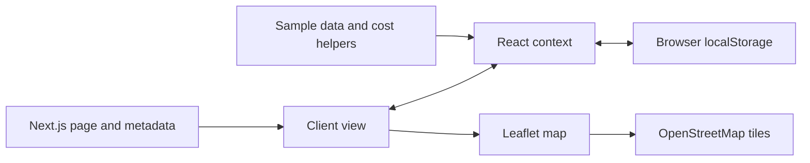
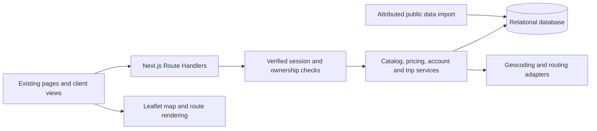

# Architecture and implementation guide

> **Planning snapshot:** “Current” and “Target” describe the October 24, 2026 baseline and proposed architecture. Consult [the documentation router](README.md) and verify the implementation before treating a design detail as current.

Everything under "Target" below is proposed. The existing system is documented in [Current state](CURRENT_STATE.md). Implement this incrementally; keep the current screens and replace their demo data boundaries.

## Current flow



Next.js serves the application, but localStorage is currently the effective product datastore. There is no shared identity or trusted mutation boundary.

## Target: one application with clear server boundaries



Use one Next.js application for the two-person release. Keep server-only data access and credentials behind Route Handlers/services; keep interactive forms and Leaflet in client components. Server Components may read server services directly when rendering public data. Do not add an independent backend service unless a demonstrated requirement needs one.

Before writing Next.js implementation code, read the installed guides required by [AGENTS.md](../AGENTS.md), especially:

- `node_modules/next/dist/docs/01-app/01-getting-started/15-route-handlers.md`
- `node_modules/next/dist/docs/01-app/01-getting-started/05-server-and-client-components.md`
- `node_modules/next/dist/docs/01-app/02-guides/authentication.md`
- `node_modules/next/dist/docs/01-app/01-getting-started/17-deploying.md`

These local guides were consulted for this plan. The installed version uses App Router `route.ts` files; existing pages already await promise-based `searchParams`. Follow the installed documentation when handling dynamic route parameters, session APIs, and caching. Place APIs under `/api` so they do not conflict with existing page routes. Avoid caching private responses across users.

## Proposed code organization

| Proposed location | Purpose |
| --- | --- |
| `src/lib/domain/` | Framework-independent types, validation rules, compatibility, cost, price suggestion, and trip feasibility. No image imports, browser state, or secrets. |
| `src/lib/server/` | Server-only session checks, database repositories, catalog/quote/trip services, and ownership rules. |
| `src/lib/server/providers/` | Geocoder and road-routing adapters with timeouts and normalized results. |
| `src/app/api/` | Validated request/response boundaries invoking the server services. |
| `src/lib/client/` | Typed requests and error normalization for client views. |
| `db/` | Chosen migration format and deterministic regional seed/import scripts. |
| `tests/` | Domain, API/database, and browser workflow tests after test tooling is selected. |

Move reusable domain logic out of `src/lib/data.ts`, which currently also imports demo images and fixtures. Keep `src/lib/store.tsx` for transient UI state such as open dialogs and compare IDs. Server-backed data should come from the signed-in account, not a merged global browser snapshot. On logout/account switch, clear private client caches. Do not import old localStorage reservations or ownership flags into trusted records automatically.

## Proposed data model

Choose a migration-capable relational store. Exact products and query libraries remain a team decision.

| Entity | Important fields and relationships |
| --- | --- |
| Profile | Internal ID, unique auth-subject ID, display name, optional contact data. Credentials/session secrets belong to the selected auth system. |
| Vehicle | ID, owner ID, nickname, make/model/year, battery kWh, efficiency mi/kWh, connector. |
| Preferences | One row per user; default vehicle ID belonging to that user, radius, connector preferences, travel-energy rate, supported units/theme. |
| Charger | ID, source (`peer`/`public`), nullable owner ID for public records, external source ID, connector, level, power, energy price, flat fee, published/paused status, known availability, source/update timestamps. |
| ChargerLocation | Charger ID, private exact address/coordinates, public approximate location, neighborhood, timezone. Restrict exact fields according to the agreed policy. |
| AvailabilityWindow | Charger ID, days, local opening/closing times; define timezone and whether overnight windows are supported. |
| Favorite | Unique pair `(user_id, charger_id)` with foreign keys. |
| Photo, optional | Charger ID, storage reference and order. Until implemented, identify placeholder images. |
| Reservation, optional | One record for driver and host views: charger/driver/vehicle IDs, start/end timestamps, status, energy request, quote snapshot, payable amount. |

Enforce ownership, uniqueness, nonnegative rates/fees, positive capacity/efficiency/power, coordinate ranges, and valid schedule intervals. Define decimal precision for fractional USD/kWh rates; use a decimal-safe representation for money and round only at the agreed quote boundary. Use immutable IDs and UTC timestamps; preserve the listing's timezone for opening hours. Public charger records with unknown pricing/status must retain that uncertainty.

## Proposed API contracts

Agree on these contracts before A and B implement opposite ends. They are not existing endpoints.

| Endpoint | Behavior | Access |
| --- | --- | --- |
| Auth integration routes | Signup/sign-in/sign-out/session/reset as supported by the chosen integration. | Integration-defined; verified session server-side. |
| `GET /api/me` | Profile, supported preferences, default vehicle. | Signed-in user only. |
| `PATCH /api/me` | Validate profile/preferences; default vehicle must be owned. | Signed-in user only. |
| `GET/POST /api/vehicles` | Read or create the user's vehicles. | Signed-in user only. |
| `PATCH/DELETE /api/vehicles/[id]` | Update/remove an owned vehicle; handle default selection. | Vehicle owner only. |
| `GET /api/favorites` | Read the user's favorite charger references. | Signed-in user only. |
| `PUT/DELETE /api/favorites/[chargerId]` | Idempotent favorite/unfavorite. | Signed-in user only. |
| `GET /api/chargers` | Paginated public catalog; validated location, connector, availability, radius, and source filters. | Public sanitized records. |
| `GET /api/chargers/[id]` | Sanitized detail or real 404; exact fields follow access policy. | Public or policy-authorized detail. |
| `POST /api/chargers` | Validate listing; derive owner from session; geocode and save. | Signed-in host. |
| `PATCH /api/chargers/[id]` | Update or pause an owned listing. | Listing owner only. |
| `POST /api/quotes` | Shared cost/ranking calculation for explicit origin, energy, vehicle assumptions, and candidate/filter inputs. | Public estimates; verify ownership if a private vehicle ID is supplied. |
| `POST /api/trips` | Geocode endpoints, route, and return feasible charging-stop plan. | Public estimates with explicit inputs; private vehicle lookup requires its owner. |

Use stable error codes such as `VALIDATION_ERROR`, `UNAUTHENTICATED`, `FORBIDDEN`, `NOT_FOUND`, `PROVIDER_UNAVAILABLE`, and `NO_FEASIBLE_PLAN`. Distinguish an unavailable provider from an evaluated trip with no feasible stops. Bound payload size, candidate counts, and expensive request frequency. Reject client-supplied ownership and authoritative totals. Document exact request/response shapes during T02.

## Cost rules

For charger discovery, normalize units to miles, kWh, and USD:

```text
charging_energy_cost = requested_kWh * charger_rate_USD_per_kWh
charger_payable = charging_energy_cost + flat_charger_fee
travel_energy_kWh = round_trip_road_miles / vehicle_efficiency_mi_per_kWh
travel_cost = travel_energy_kWh * assumed_travel_energy_rate_USD_per_kWh
estimated_total_cost = charger_payable + travel_cost
```

Use outbound plus return driving distance when roads differ by direction. Doubling a one-way value is an explicitly labeled approximation. Apply eligibility filters before ranking; sort total cost first with deterministic distance/ID tie-breakers. Keep a separate rating-based recommendation only if its label explains that objective.

Return the breakdown, distances, units, assumptions, pricing timestamp, and source-quality information. Do not rank unknown-price records as free. List/detail/compare must use the same request assumptions and quote service. The comparison page should stop silently assuming 30 kWh.

Travel cost belongs in a driver's comparison, not in a host's bill. Optional booking must snapshot `charger_payable` separately from `estimated_total_cost`. Estimated energy delivery does not establish metered usage or an actual payment.

Initially preserve `max(homeRate * 1.4, homeRate + 0.05)` as the proposed host-price heuristic. This is a 40% **markup** option, not a 40% profit margin. Centralize rounding and apply the same rule to the suggestion and default price; document any configurable markup alternative before changing it.

## Routing and stop feasibility

1. Validate endpoint strings/coordinates, vehicle capacity/efficiency, starting battery percentage, reserve percentage, and maximum detour.
2. Geocode endpoints with a provider adapter; obtain a drivable route's geometry and distances. Tile rendering alone provides neither geocoding nor routing.
3. Find published, compatible candidates near that route. Confirm driving access and exclude unknown/unavailable status from any claim of guaranteed eligibility; state the available data's limitations.
4. Evaluate route-ordered stop sequences. For each road leg, energy demand is `leg_miles / efficiency`; arrival energy must stay at or above the reserve. Departure energy cannot exceed battery capacity.
5. Include charging energy/time, fees, detours, and opening windows at projected arrival. An MVP charging-time estimate may use `energy / min(charger_power, known_vehicle_limit)`; clearly label a constant-power approximation when taper/vehicle limits are unknown.
6. Choose the lowest evaluated feasible cost under the configured candidate/stop limits. Start with a bounded regional search and deterministic fixtures; report its limits. Do not claim a global optimum for a heuristic or straight-line calculation.
7. Return route geometry, leg distances, stops, charge amounts, arrival/departure battery estimates, approximate time/cost, and warnings. A no-stop route is a valid result. If no evaluated sequence works, say no feasible plan was found within the configured bounds.

For trip ranking, count the chosen stop energy/fees and incremental detour travel energy once. Do not add a round trip back to the starting location for every stop; discovery and point-to-point trips have different travel objectives.

The existing map accepts a `route` array; B can adapt provider geometry to its `[latitude, longitude]` tuples. Check coordinate ordering because some provider responses use longitude first.

## Configuration and deployment

Create a tracked `.env.example` with variable names and setup notes after choosing integrations. Use a server-only database connection, auth/session configuration, and geocoding/routing credentials. Only intentionally public tile configuration belongs in public client variables. Never commit actual keys.

Use separate development/test/deployed data. Add migrations, repeatable sample seeds, health diagnostics, structured errors, and a backup/restore procedure. Deploy to a server-capable Next.js environment because authentication and mutations need a server; a static export cannot satisfy this target. See [SDLC](SDLC.md) for release/rollback steps.

## Decision log

All entries start as proposed. Replace each with the chosen option, rationale, owner, date, and consequences when decided.

| ID | Decision to record | Lead |
| --- | --- | --- |
| ADR-01 | Database, migration tool, and identity integration. | A |
| ADR-02 | Geocoding, road distances, routing, tile services, quotas, and source attribution. | B |
| ADR-03 | Money precision, travel-rate assumption, host markup, and ranking rules. | Both |
| ADR-04 | Public/exact home-location fields and permitted disclosure. | Both |
| ADR-05 | Regional dataset, route search bounds, capacity, and release exclusions. | Both |
